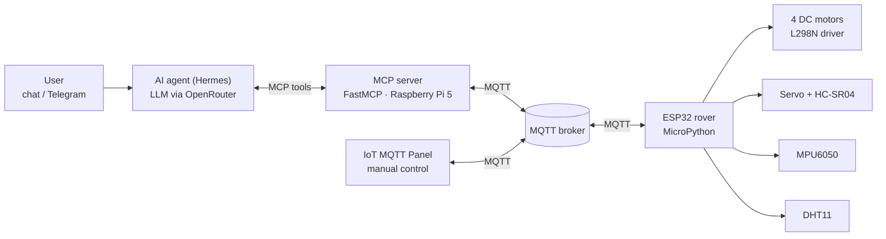

# Vučko – AI-Controlled Autonomous ESP32 Rover

Vučko is an autonomous four-wheel rover built on an ESP32 running MicroPython. It can be driven manually over MQTT, or controlled in natural language by an LLM agent that talks to the rover through an MCP server running on a Raspberry Pi 5.

Built for the Embedded Systems course at the Faculty of Electrical Engineering, University of Sarajevo (2026), by Team 18.

**Demo video:** https://youtu.be/92EGSl7-Scg

## Features

- **Heading control** – PID controller on the MPU6050 gyroscope keeps the rover driving straight and turning to an exact angle.
- **Obstacle avoidance** – an HC-SR04 ultrasonic sensor mounted on a servo detects obstacles and looks left and right to find the free side; the rover then drives around the obstacle and returns to its original heading.
- **Environment sensing** – temperature and humidity from a DHT11 sensor, on request.
- **Area scan** – the rover drives the perimeter of a given rectangle and samples temperature and humidity at a fixed step, returning the results as a map.
- **MQTT protocol** – JSON commands and sensor data over MQTT, with keepalive and automatic reconnection.
- **Natural-language control** – an MCP server exposes the rover's functions as tools, so an AI agent can carry out commands such as *"Make a temperature map of a 2 m × 2 m area"*. The agent can also be reached through Telegram.

## Architecture



## Hardware

| Component | Purpose | ESP32 pins |
| --- | --- | --- |
| ESP32 dev board | Runs the MicroPython firmware | – |
| 4 DC motors + L298N dual H-bridge | Drive (two channels, left and right side) | IN1–IN4: 27, 26, 25, 33 · ENA/ENB (PWM 1 kHz): 14, 32 |
| MPU6050 | Gyroscope for heading control | I2C |
| HC-SR04 | Distance to obstacles | TRIG 12 · ECHO 13 |
| Servo | Turns the ultrasonic sensor left and right | 15 (PWM 50 Hz) |
| DHT11 | Temperature and humidity | 4 |
| Raspberry Pi 5 | Runs the MCP server and the AI agent | – |

## How it works

**Control loop.** Driving runs in a fixed-rate loop at 50 Hz (20 ms period). The gyroscope bias is calibrated at startup from 300 samples, and the heading is obtained by integrating the gyroscope's Z axis. A PID controller (Kp = 95, Ki = 0.06, Kd = 2.5, integral clamped to ±40 against wind-up) corrects the PWM of the left and right motors, with a static offset that compensates for the difference between the two motor channels.

**Distance.** The rover has no wheel encoders, so distance is estimated from time at a calibrated speed of 57.5 cm/s.

**Obstacles.** During driving the distance is checked every third control cycle. Below 15 cm the rover stops and turns the servo to measure both sides. It then turns towards the free side and drives around the obstacle in a rectangular manoeuvre, with the servo pointing the sensor at the obstacle so it knows when it has passed it (25 cm side clearance), and finally returns to the original heading.

**MQTT robustness.** The client uses a 60 s keepalive and pings the broker every 5 s from the main loop. On an error it disconnects, waits 2 s, reconnects and subscribes to the command topic again.

**Sensor requests.** A DHT11 request arriving through the MQTT callback only sets a flag; the actual measurement runs in the main loop, which keeps the callback short. If a reading fails, the last valid value is used.

**MCP tools.** Because MQTT is asynchronous, sensor tools work in two phases: a *request* tool publishes a command, and a *read* tool returns the latest message, a "waiting" status, or a timeout. This keeps every tool call short for the agent.

## MQTT topics

| Topic | Direction | Content |
| --- | --- | --- |
| `vucko/esp32/komande` | server → rover | Movement, scan and sensor commands |
| `vucko/esp32/senzori` | rover → server | Distance and heading angle |
| `vucko/tasmota/dht11` | rover → server | Temperature and humidity |
| `vucko/esp32/matrica` | rover → server | Area scan results |

Example commands (published to `vucko/esp32/komande`):

```json
{"komanda": "vozi", "smjer": "naprijed", "udaljenost": 100, "izbjegavajPrepreke": true}
{"komanda": "okreni", "stepeni": 90}
{"komanda": "stani"}
{"komanda": "matrica", "duzinaKocke": 180, "sirinaKocke": 180, "duzinaKoraka": 30, "izbjegavajPrepreke": true}
{"komanda": "zahtjev_dht", "zahtjeva": "oboje"}
{"komanda": "zahtjev_navigacija", "zahtjeva": "oboje"}
```

## MCP tools

| Tool | What it does |
| --- | --- |
| `posaljiKomanduVoznji(smjer, udaljenost_cm, izbjegavajPrepreke)` | Drive forward or backward a given distance |
| `posaljiKomanduOkret(stepeni)` | Rotate in place by a given angle |
| `posaljiKomanduStop()` | Emergency stop |
| `zahtjevajOcitavanjeDHT(zahtjeva)` / `ocitajAtmosferskeParametre()` | Request and read temperature and humidity |
| `zahtjevajNavigacijskePodatke(zahtjeva)` / `ocitajStatuseVozila()` | Request and read distance and heading |
| `posaljiKomanduMatrica(...)` / `ocitajMatricuProstora()` | Start an area scan and read its results |
| `izlistaj_aktivne_uredjaje()` | Diagnostics: which topics are active and how old their last message is |

## Getting started

### Firmware (ESP32)

1. Flash MicroPython to the ESP32.
2. Install the MQTT client: `mpremote mip install umqtt.robust`
3. Add an MPU6050 driver as `mpu6050.py` (it must provide a `MPU6050` class with `read_gyro_data()` returning a dict with a `"z"` key).
4. Copy `firmware/config.example.py` to `firmware/config.py` and fill in your WiFi and MQTT settings.
5. Upload the files and reset the board:
   ```bash
   mpremote cp firmware/main.py firmware/config.py mpu6050.py :
   mpremote reset
   ```

### MCP server

```bash
cd mcp-server
python3 -m venv .venv
source .venv/bin/activate
pip install -r requirements.txt
export US_MQTT_HOST=<broker address>   # optional: US_MQTT_PORT (default 1883), US_TIM
python server.py
```

The server uses the stdio transport, so it can be registered in any MCP-capable agent. In this project it was used by the Hermes agent with an LLM served through OpenRouter, and the agent was also reachable through Telegram.

### Manual control

Any MQTT client works, for example:

```bash
mosquitto_pub -h <broker> -t vucko/esp32/komande -m '{"komanda": "vozi", "smjer": "naprijed", "udaljenost": 50, "izbjegavajPrepreke": true}'
```

## Project structure

```
firmware/
  main.py             MicroPython firmware for the ESP32
  config.example.py   template for WiFi and MQTT settings (config.py is not committed)
mcp-server/
  server.py           FastMCP server that bridges the AI agent and MQTT
  requirements.txt
```

Code identifiers and log messages are in Bosnian.

## Team

Team 18 – Embedded Systems course, Faculty of Electrical Engineering, University of Sarajevo (2026).
Software (firmware and MCP server): Tarik Beganović.
